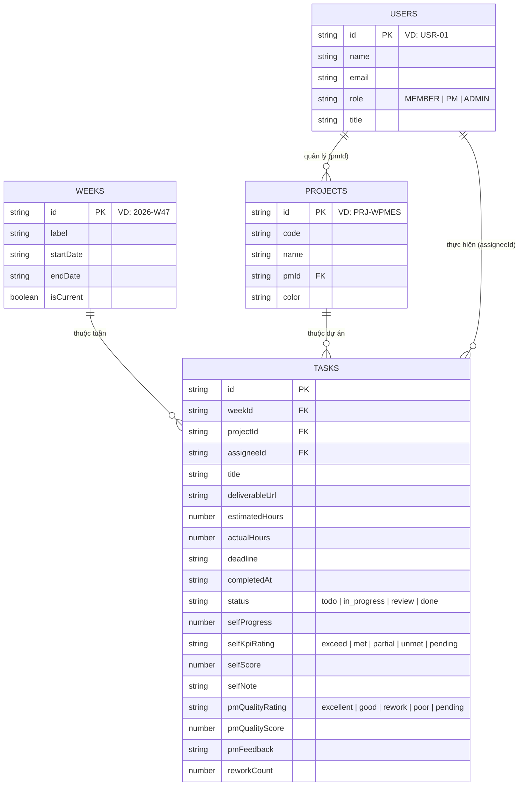

# Tài liệu Thiết kế Hệ thống: WPMES
**Work Performance Management and Evaluation System — Hệ thống Quản trị Công việc theo Tuần & Dự án, Đánh giá KPI Đa chiều và Trợ lý AI Phân tích Hiệu suất**

---

## 1. Bối cảnh & Mục tiêu Bài toán
Hệ thống **WPMES (Work Performance Management and Evaluation System)** được thiết kế phục vụ quản trị hiệu suất công việc theo tuần và dự án cho doanh nghiệp đa công ty, với 4 yêu cầu cốt lõi:
1. **Cá nhân chủ động Log Task** theo từng tuần làm việc và theo từng dự án tham gia (có hỗ trợ AI bóc tách từ ngôn ngữ tự nhiên).
2. **Cá nhân Tự đánh giá KPI cuối tuần**: Cập nhật % hoàn thành, giờ thực tế, link minh chứng (PR/Tài liệu), mức tự đánh giá KPI và giải trình nguyên nhân nếu trễ hạn.
3. **PM Đánh giá Chất lượng (Quality Gate)**: Kiểm soát chất lượng đầu ra độc lập (`Xuất sắc`, `Đạt chuẩn`, `Cần sửa lại - Rework`, `Chưa đạt chất lượng`), chấm điểm chất lượng (0-100) và ghi nhận xét chi tiết; có AI Pre-Check cảnh báo bất thường.
4. **AI Hỗ trợ Tổng hợp & Giám sát**:
   - Tự động phát hiện và tổng hợp **ai chưa đạt chất lượng** (kèm nguyên nhân từ nhận xét PM và khuyến nghị khắc phục).
   - Tự động phát hiện và tổng hợp **ai chậm deadline** (phân loại nguyên nhân khách quan vs chủ quan từ giải trình cá nhân).
   - Cảnh báo **độ lệch Tự đánh giá vs PM** ($\text{SelfScore} - \text{PMScore} \ge 20$).
   - Cho phép quản lý **xem chi tiết công việc 360° của từng người** theo từng dự án, từng tuần và hỏi đáp tự nhiên qua **AI Copilot**.

---

## 2. Kiến trúc Phân tách Frontend / Backend (Decoupled MERN Stack)
- **Frontend (`frontend/`) — Port `5173`**:
  - **React 18 + Vite + Tailwind CSS + Lucide Icons**.
  - Giao tiếp với Backend qua `VITE_API_BASE_URL=http://localhost:5000/api` (và hỗ trợ Vite dev proxy `/api`).
- **Backend (`backend/`) — Port `5000`**:
  - **Node.js + Express.js REST API** (`backend/src/app.js`, `backend/src/routes/api.js`, `backend/src/index.js`).
  - **MongoDB + Mongoose ODM** (`backend/src/models/Project.js`, `User.js`, `Week.js`, `Task.js`), kèm cơ chế **Dual-Mode Fallback** (`backend/src/db/database.js`) tự động lưu JSON cục bộ (`backend/src/db/data.json`) nếu service `mongod` chưa chạy.
- **AI Engine (`backend/src/services/aiService.js`)**:
  - **Deterministic Grounded Analytics Engine**: Tính toán số liệu chính xác 100% từ MongoDB trước khi tổng hợp báo cáo Watchdog & Employee 360°.
  - **NLP Smart Task Parser**: Bóc tách mô tả tự nhiên tiếng Việt thành danh sách Task chuẩn (Dự án, Số giờ, Deadline, Phân loại).
  - **Optional Gemini 2.5 Flash Integration**: Nâng cấp câu trả lời tự nhiên cho AI Copilot khi cấu hình `GEMINI_API_KEY`.

---

## 3. Thiết kế Cơ sở Dữ liệu MongoDB (ERD)

---

## 4. Công thức Tự động (Lark Base Formula Engine - `backend/src/services/kpiService.js`)

1. **Trạng thái Deadline (`deadlineStatus`)**:
   - Nếu đã `done`: $\text{completedAt} > \text{deadline} \Rightarrow$ `Hoàn thành trễ (late_done)`, ngược lại `Đúng hạn (on_time)`.
   - Nếu chưa `done`: $\text{currentDate} > \text{deadline} \Rightarrow$ `Quá hạn chưa xong (overdue)`.
2. **Hệ số Đúng hạn (`deadlineFactor`)**:
   $$\text{deadlineFactor} = \begin{cases} 1.0 & \text{nếu đúng hạn} \\ \max(0.6,\ 1.0 - \text{daysLate} \times 0.05) & \text{nếu trễ hạn} \end{cases}$$
3. **Điểm KPI Cuối cùng của Task (`finalKpiScore`)**:
   $$\text{finalKpiScore} = \text{round}\big((0.3 \times \text{selfScore} + 0.7 \times \text{effectiveQualityScore}) \times \text{deadlineFactor}\big)$$
4. **KPI Tuần của Nhân sự (`finalWeekKpi`)**:
   Trung bình có trọng số theo `estimatedHours` của tất cả các task trong tuần.
